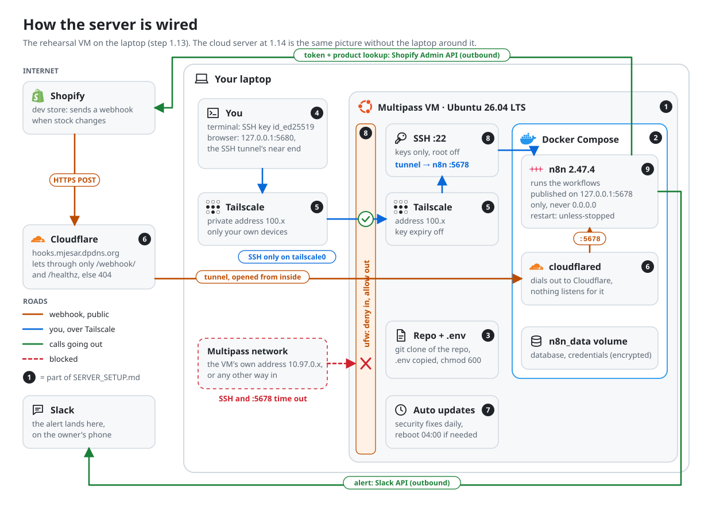
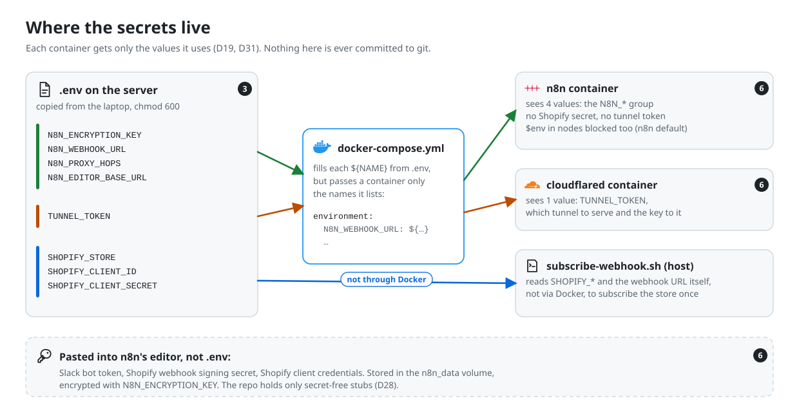

# Setting up the server

Every command that turns a fresh Ubuntu machine into the server that runs this stack, in
order, with what each one is for. It was written while rehearsing on a local Multipass VM
(step 1.13 in [phases/01-backbone.md](phases/01-backbone.md)), and it is the script for the
real server at step 1.14.

The rehearsal VM is a stand-in for the cloud machine. It runs only while the laptop is on,
so it is somewhere to make mistakes for free, not a place to run the store from.

## The finished server at a glance

What the nine parts below build, and the only roads in and out. The numbers match the parts.

<picture>
  <source media="(prefers-color-scheme: dark)" srcset="images/server-setup-network-dark.svg">
  
</picture>

<details>
<summary>Text version of the picture</summary>

The laptop holds the Multipass VM (part 1), which runs Ubuntu 26.04 LTS. Inside it, Docker
Compose (part 2) runs two containers: `n8n` and `cloudflared`. n8n keeps its data in the
`n8n_data` volume. Next to them are the repo and `.env` (part 3), SSH (parts 4 and 8),
Tailscale (part 5) and automatic updates (part 7). A firewall, `ufw` (part 8), wraps the VM:
it denies everything coming in and allows everything going out.

Four roads:

- **Webhook, public.** Shopify sends an HTTPS POST to Cloudflare at
  `hooks.mjesar.dpdns.org`, which lets through only `/webhook/` and `/healthz`. Cloudflare
  passes it down the tunnel that `cloudflared` opened from inside the VM (part 6), and
  `cloudflared` hands it to n8n on port 5678. Nothing on the VM listens for the internet.
- **You, over Tailscale.** The laptop's terminal holds the SSH key. It reaches the VM's
  Tailscale address, the firewall's one open gate (SSH on `tailscale0`), then SSH, and an
  SSH tunnel carries the browser from `127.0.0.1:5680` on the laptop to the editor on
  `127.0.0.1:5678` inside the VM.
- **Calls going out.** n8n calls Shopify's Admin API (a token, then the product lookup)
  and Slack's API (the alert). Outgoing traffic is allowed.
- **Blocked.** Anything else, such as SSH or port 5678 on the VM's Multipass address
  `10.97.0.x`, hits the firewall and times out. n8n is published on `127.0.0.1` only
  (part 9), so Docker does not open it past the firewall.

On the cloud server at 1.14 the picture is the same without the laptop around it.

</details>

Where each secret lives, and which container can see it:

<picture>
  <source media="(prefers-color-scheme: dark)" srcset="images/server-setup-secrets-dark.svg">
  
</picture>

<details>
<summary>Text version of the picture</summary>

`.env` on the server (copied from the laptop, `chmod 600`, never in git) holds nine values
in three groups:

- `N8N_ENCRYPTION_KEY`, `N8N_WEBHOOK_URL`, `N8N_PROXY_HOPS`, `N8N_EDITOR_BASE_URL`: Docker
  Compose passes these four, and only these, to the n8n container (D31). n8n also blocks
  `$env` in nodes by default.
- `TUNNEL_TOKEN`: passed only to the `cloudflared` container (D19). It says which tunnel to
  serve and is the key to it.
- `SHOPIFY_STORE`, `SHOPIFY_CLIENT_ID`, `SHOPIFY_CLIENT_SECRET`: no container gets these.
  `scripts/subscribe-webhook.sh` reads them on the host, with the webhook URL, to subscribe
  the store once.

Compose fills each `${NAME}` in `docker-compose.yml` from `.env`, but a container receives
only the names listed under its own `environment:`.

The secrets n8n itself uses (the Slack bot token, the Shopify webhook signing secret and the
Shopify client credentials) are pasted into n8n's editor, not `.env`. n8n stores them in the
`n8n_data` volume, encrypted with `N8N_ENCRYPTION_KEY`, and the repo holds only
secret-free stubs (D28).

</details>

## 1. Create the machine

On the laptop. Multipass on Linux ships as a snap, from Canonical, who also make Ubuntu.

```
sudo snap install multipass
multipass find
multipass launch 26.04 --name store-ai-crew --cpus 2 --memory 2G --disk 10G
multipass info store-ai-crew
```

- `multipass find` lists the images. The server runs the newest **LTS** (5 years of
  updates), not the newest release: 26.10 was listed too, but it is not LTS.
- The image is launched as `26.04`, not by the alias `lts`. An alias moves to the next LTS
  when it ships, so a rebuild from these notes would get a different OS.
- The size (2 CPUs, 2 GB memory, 10 GB disk) is close to a small cloud machine. Memory and
  disk are upper limits, taken from the laptop only as the VM uses them.

Result:

| Item | Value |
| --- | --- |
| Multipass | 1.17.2 (snap, stable channel) |
| Image | Ubuntu 26.04.1 LTS, image hash `7b90593f5532` |
| Address | `10.97.0.38`, private, reachable only from the laptop |
| Memory at idle | 368 MiB of 1.9 GiB |
| Disk at start | 2.2 GiB of 9.6 GiB |

To pause and resume without losing anything: `multipass stop store-ai-crew` and
`multipass start store-ai-crew`. A stopped VM uses no memory.

To get a terminal inside the VM: `multipass shell store-ai-crew` (the prompt becomes
`ubuntu@store-ai-crew`, and `exit` goes back to the laptop). On the cloud machine this is
SSH instead.

## 2. Install Docker

On the server. "On the server" in these notes means a terminal inside the VM, opened from
the laptop with:

```
multipass shell store-ai-crew
```

The prompt becomes `ubuntu@store-ai-crew`. This works only until part 8 turns on the
firewall; from part 5 on, SSH over Tailscale is the way in. On the cloud machine there is
no Multipass, so it is SSH from the start.

This follows Docker's own guide for Ubuntu
([docs.docker.com/engine/install/ubuntu](https://docs.docker.com/engine/install/ubuntu/)),
the apt repository method. Ubuntu's own `docker.io` package is skipped because it lags
behind Docker's releases. A fresh machine has no old Docker packages, so the guide's
"uninstall old versions" step is skipped too.

Tools needed to fetch the key:

```
sudo apt update && sudo apt install ca-certificates curl
```

Docker's signing key, in its own folder, so apt trusts it only for Docker's repository:

```
sudo install -m 0755 -d /etc/apt/keyrings
sudo curl -fsSL https://download.docker.com/linux/ubuntu/gpg -o /etc/apt/keyrings/docker.asc
sudo chmod a+r /etc/apt/keyrings/docker.asc
```

The repository itself. The two `$(...)` parts fill in the Ubuntu codename and the CPU type,
so the same lines work on an x86 VM (`amd64`) and on an Arm cloud machine (`arm64`):

```
sudo tee /etc/apt/sources.list.d/docker.sources <<EOF
Types: deb
URIs: https://download.docker.com/linux/ubuntu
Suites: $(. /etc/os-release && echo "${UBUNTU_CODENAME:-$VERSION_CODENAME}")
Components: stable
Architectures: $(dpkg --print-architecture)
Signed-By: /etc/apt/keyrings/docker.asc
EOF
sudo apt update
```

`apt update` must show a line for `download.docker.com/linux/ubuntu resolute InRelease`
with no signature error.

Install the newest version by its exact version string, so the version running is a
choice made at this step and written down, not whatever apt picked that day. Do not copy a version from these notes: a newer one has usually shipped by then. List
what exists first; the top line is the newest:

```
apt list --all-versions docker-ce
```

Put that version string (the part after `docker-ce/resolute`, for example
`5:29.10.1-1~ubuntu.26.04~resolute`) in place of `<version>`:

```
VERSION_STRING=<version>
sudo apt install docker-ce=$VERSION_STRING docker-ce-cli=$VERSION_STRING containerd.io docker-buildx-plugin docker-compose-plugin
```

On an Arm machine the version string is the same, and apt picks the `arm64` build. Record
the version installed in the table below.

Check:

```
sudo docker run hello-world
sudo docker version
docker compose version
```

`hello-world` printing "Hello from Docker!" proves the whole chain: the client reaches the
engine, the engine pulls from Docker Hub, and a container runs.

| Piece | Version installed (2026-11-26 rebuild) |
| --- | --- |
| Docker Engine and CLI | 29.10.1 (pinned; the first build on 2026-11-23 got 29.10.0) |
| containerd | 2.4.2 |
| runc | 1.5.3 |
| Docker Compose plugin | 5.8.0 |

## 3. Bring the project over

On the server. The repo is public, so a read-only HTTPS clone needs no keys. Updates later
are a `git pull` instead of copying files by hand.

```
git clone https://github.com/mjesar/store_ai_crew.git
```

The `.env` holds the secrets and is never in git, so it is copied from the laptop. This
runs on the laptop, not in the VM shell (`exit` it, or use a second terminal), from the
laptop's own copy of the project, the folder where `.env` lives:

```
multipass transfer .env store-ai-crew:/home/ubuntu/store_ai_crew/.env
```

(On the cloud machine this is `scp` over Tailscale instead.) Then, on the server, make it
readable by its owner only, so no other account or service on the machine can read the
secrets:

```
chmod 600 store_ai_crew/.env
ls -la store_ai_crew/.env    # -rw------- 1 ubuntu ubuntu ...
```

## 4. SSH with a key

The n8n editor listens only on `127.0.0.1` inside the server, so it is never public. To
open it from the laptop's browser, the laptop needs SSH into the server, and later an SSH
tunnel through it. SSH logs in with a key pair: the private key stays on the laptop, and
the server lists the matching public key in `~/.ssh/authorized_keys`.

On the laptop. `multipass transfer` cannot read `~/.ssh` (the snap is not allowed into
hidden folders in the home directory), so the laptop's shell reads the key and pipes it to
a command inside the VM. `>>` appends, so the key Multipass itself uses stays in the list:

```
multipass exec store-ai-crew -- bash -c 'cat >> ~/.ssh/authorized_keys' < ~/.ssh/id_ed25519.pub
ssh ubuntu@<vm-ip>
```

`<vm-ip>` is the `IPv4` line of `multipass info store-ai-crew`. It changes each time the VM
is created (`10.97.0.38` the first time, `10.97.0.83` on the rebuild), so take it from
there, not from these notes.

Done when the login works without a password. The first connection asks to trust the
server's fingerprint; after that, SSH warns if a different machine answers at that address.

On the cloud machine the public key is given at creation time instead, in the provider's
console.

## 5. Tailscale

Tailscale joins the laptop and the server into one private network (a "tailnet"). Each
device gets a `100.x.x.x` address that only other devices in the tailnet can reach, from
anywhere. SSH and the n8n editor will be reachable only this way, so the server shows the
internet no door to knock on. Shopify still reaches n8n through the Cloudflare Tunnel,
which is a separate, public path for the webhook only.

How it works: Tailscale's servers keep the member list and hand each device the others'
public keys. The traffic itself goes directly between the devices, encrypted with
WireGuard, or through a Tailscale relay when a direct path is blocked. Either way Tailscale
cannot read it.

Free "Personal" plan: up to 6 users, unlimited devices, non-commercial use (checked
2026-11-23 on tailscale.com/pricing).

On the laptop and then on the server, the install script from Tailscale's Linux guide
(it adds Tailscale's apt repository and installs the package). A laptop already in the
tailnet skips this. When rebuilding a server, first remove the old one in the admin
console (Machines, `...`, Remove), or the new one joins under a changed name such as
`store-ai-crew-1`.

```
curl -fsSL https://tailscale.com/install.sh | sh
sudo tailscale up
tailscale ip -4
```

On the laptop, `tailscale up` opens a login (the first one creates the tailnet). On the
server it prints a link instead: open it in the laptop's browser and click Connect. Treat
that link as a secret until it is used, since whoever opens it can add a device to the
tailnet.

Then SSH over the Tailscale address, from the laptop:

```
ssh ubuntu@<tailscale-ip>
```

`<tailscale-ip>` is what `tailscale ip -4` printed on the server. SSH asks again to trust
the host, because it remembers hosts by address. The fingerprint must match the one from
the first login in part 4; when it does, SSH also notes the key is already known under
another address. A different fingerprint means a different machine answered: stop there.

| Device | Tailnet name | Address | Tailscale |
| --- | --- | --- | --- |
| Laptop | `mj-01` | `100.102.132.58` | 1.104.7 |
| Rehearsal VM | `store-ai-crew` | `100.75.10.127` (first build: `100.117.248.13`) | 1.104.7 |

Last, in the Tailscale admin console (Machines, the `...` menu on the server's row):
**Disable key expiry** for the server only. A device's login expires after 180 days by
default, which is a good safety net for a laptop. On a server reachable only over
Tailscale, it would mean a silent lockout months later. The row then shows "Expiry
disabled".

## 6. Run the stack and move the tunnel

On the server, start **n8n only**. The tunnel waits until n8n is set up: an empty n8n
would fail every webhook, and after 8 failures in a row Shopify deletes the subscription.

```
cd ~/store_ai_crew && sudo docker compose up -d n8n
```

`sudo` is needed because only root may use Docker on this machine (see the hardening part
for why that stays so).

Open the editor from the laptop through an SSH tunnel over Tailscale. The editor listens
only on `127.0.0.1` inside the server, so this is the only way in. The command looks stuck
while the pipe is open; Ctrl+C closes it:

```
ssh -N -L 5680:localhost:5678 ubuntu@<tailscale-ip>
```

Then browse to `http://127.0.0.1:5680`. Laptop port 5680, because a local n8n may already
use 5678. Use `127.0.0.1` and not `localhost`: n8n's login cookie is per host name, not
per port, so `localhost:5680` would log the laptop's own editor out.

Create the owner account (a placeholder email such as `owner@example.com` works: n8n uses
it only as a login name and sends no mail). The account lives in n8n's database on this
machine, not in the repo, so every new machine needs it once; restarts and upgrades keep
it. It is not scripted, since that would put one more password in `.env` for a step done
once per machine. Create it before the restore: imported workflows and credentials need an
owner. Then restore the workflows and credential
stubs, following [RESTORE.md](RESTORE.md) steps 4 to 6. `jq` is needed by the script and
was already on the Ubuntu image; `sudo apt install jq` is harmless if it is.

```
sudo ./scripts/restore-n8n.sh
```

Paste the three secrets in the editor, then publish `Failure alert` first and
`Low stock alert` second.

Move the tunnel. Whichever machine runs `cloudflared` receives the webhooks, so the old
machine stops first, or Cloudflare would split deliveries between the two. On the laptop:

```
docker compose stop
```

`stop` keeps the containers and data, and with `restart: unless-stopped` they stay down
after a reboot too. Then on the server:

```
sudo docker compose up -d cloudflared
sudo docker compose logs cloudflared | grep -i "registered tunnel connection"
```

Four "Registered tunnel connection" lines mean the tunnel is up. The webhook address in
Shopify does not change: `TUNNEL_TOKEN` tells Cloudflare which tunnel this is, and the
hostname is routed to the tunnel in Cloudflare's dashboard, not on the server.

Check: lower a product's stock in the Shopify admin. A Slack alert arrives, and the run
shows green in the server's n8n under Executions.

## 7. Updates: now and from then on

On the server. A fresh image is already weeks old, so install what came out since:

```
sudo apt update && sudo apt upgrade
cat /var/run/reboot-required
```

If the second line prints `*** System restart required ***` (usually a new kernel), reboot.
`exit` would only close the connection; the new kernel loads only on a restart.

```
sudo reboot
```

SSH drops. About 30 seconds later, log in again over Tailscale and check that the stack
came back on its own, with no one starting it:

```
ssh ubuntu@<tailscale-ip>
cd ~/store_ai_crew && sudo docker compose ps    # both containers "Up"
```

Automatic security updates (`unattended-upgrades`) are on by default in Ubuntu server
images. Check the switch rather than assume it:

```
cat /etc/apt/apt.conf.d/20auto-upgrades
```

Both lines must say `"1"` (every day). A dry run proves the tool works and shows where it
takes updates from:

```
sudo unattended-upgrade --dry-run --debug 2>&1 | grep -E "Allowed origins|No packages found|error" -i
```

The allowed origins include `resolute-security`. Docker's repository is not among them, so
Docker upgrades stay deliberate.

By default it never reboots, so kernel fixes would wait. Reboot by itself at a quiet hour,
only when a fix needs it (D29). Our own file, so a package update cannot overwrite it:

```
sudo tee /etc/apt/apt.conf.d/52unattended-upgrades-local <<EOF
Unattended-Upgrade::Automatic-Reboot "true";
Unattended-Upgrade::Automatic-Reboot-Time "04:00";
EOF
apt-config dump | grep Automatic-Reboot
timedatectl | grep "Time zone"
```

`apt-config dump` shows the settings as apt really reads them, so a typo shows up as a
missing line. The hour is in the server's time zone. The VM inherits the laptop's
(`Asia/Karachi`); a cloud machine usually starts in UTC, where 04:00 is 09:00 in Pakistan.
There, either set the zone (`sudo timedatectl set-timezone Asia/Karachi`) or pick the hour
in UTC.

## 8. Lock the front door: SSH and the firewall

On the server. Check SSH's real settings first (`sshd -T` prints them after reading every
config file):

```
sudo sshd -T | grep -E "^(passwordauthentication|kbdinteractiveauthentication|permitrootlogin|pubkeyauthentication) "
```

Ubuntu's cloud image already has keys on and both password methods off. Only
`permitrootlogin` was `prohibit-password` (root may log in with a key), so turn it fully off.
For SSH the **first** value read wins (the opposite of apt), and the image ships
`60-cloudimg-settings.conf`, so our file gets a lower number:

```
echo "PermitRootLogin no" | sudo tee /etc/ssh/sshd_config.d/10-hardening.conf
sudo sshd -t && echo "config OK"
sudo systemctl restart ssh
sudo sshd -T | grep permitrootlogin    # permitrootlogin no
```

`sshd -t` tests the config without applying it. A restart does not drop the current
session. **Keep that session open** and log in from a second tab before closing anything:
if the new settings were broken, the open session is the way back in.

Then the firewall. SSH is kept to Tailscale by filtering on the network interface, not by
binding SSH to the Tailscale address (D30). Rules first, enable second, so the session in
use is never cut off. Run this from an SSH session over Tailscale, not `multipass shell`:

```
sudo ufw default deny incoming && sudo ufw default allow outgoing && sudo ufw allow in on tailscale0 to any port 22 proto tcp
```

Then enable it on its own line, not pasted together with the next command. `ufw enable`
asks "Proceed with operation (y|n)?", and a pasted line after it is read as the answer, so
it cancels and leaves the firewall `inactive` (seen on the rebuild). Type `y` by hand:

```
sudo ufw enable
```

Then:

```
sudo ufw status verbose
```

Status shows `active`, `deny (incoming), allow (outgoing)`, and `22/tcp on tailscale0 ALLOW
IN`. Outgoing stays open for the tunnel, Slack, Shopify, updates and Tailscale itself.

Check both doors from the **laptop** (the `➜` prompt, not a tab still logged into the
server, or the test only reaches the server from itself):

```
ssh ubuntu@<tailscale-ip>                            # logs in
ssh -o ConnectTimeout=5 ubuntu@<vm-ip>               # Connection timed out
```

If the second command asks to trust a host, or ends in "Permission denied (publickey)", it
ran on the server, which connected to itself: a firewall filters traffic from outside, not
a machine talking to itself, and the server holds no private key. Leave the server
(`exit`) and run it again from the laptop.

From here `multipass shell` and `multipass exec` no longer work on the VM, since both come
in over SSH on the Multipass network (`multipass exec` fails with "Timeout connecting to
<vm-ip>"). That is the lock working. Run commands over Tailscale instead:

```
ssh ubuntu@<tailscale-ip> 'cd ~/store_ai_crew && sudo docker compose ps'
```

## 9. The Docker port trap (seen once, on purpose)

A port published by Docker skips `ufw`. Docker writes its own rules for traffic passed
through to containers, and they are checked before ufw's list, so `ufw status` can say
"deny" while the port is wide open. The compose file avoids it by publishing the editor on
`127.0.0.1` only. To see the trap, on the server, drop that address for a moment (never
committed):

```
cd ~/store_ai_crew && sed -i 's|"127.0.0.1:5678:5678"|"5678:5678"|' docker-compose.yml
sudo docker compose up -d n8n && sudo docker compose ps n8n    # 0.0.0.0:5678->5678/tcp
```

From the laptop, with ufw active and no rule for 5678:

```
curl -s -m 5 http://<vm-ip>:5678/healthz         # {"status":"ok"}
```

The editor answers through the firewall. On a cloud machine with a public address, this
one-line slip would put the n8n login page on the internet. Fix it by restoring the
committed file:

```
git checkout docker-compose.yml && sudo docker compose up -d n8n && sudo docker compose ps n8n    # 127.0.0.1:5678->5678/tcp
```

From the laptop again (two separate lines, since `$?` holds the result of the line before):

```
curl -s -m 5 http://<vm-ip>:5678/healthz
echo "exit code: $?"    # 28, timed out
```

The lesson for the cloud: never publish a container port on all addresses, and keep the
provider's own firewall (Oracle's security list) closed to all inbound as a second lock
outside the server, where Docker cannot write rules.
